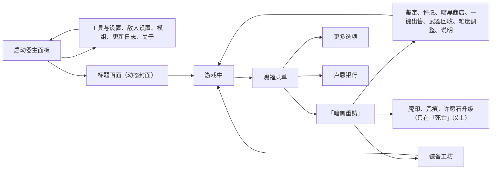

# 界面与无障碍

**负责人：** xp271 · **状态：** 按 v0.10.12 的实现整理 · **上次审阅：** 2026-11-17

玩家碰到的界面分两部分：游戏外的启动器（网页界面），游戏里原版的菜单加上赐福里的「暗黑重铸」。

## 界面与流程

_界面流程_

- **启动器主面板**：一键启动（敌人随机 / 不开敌人随机）、一键重随物品、一键重随敌人、导出诊断包、恢复存档、检查更新。存档里有「死亡」以上的角色时，一键启动会先问这次用哪种难度启动。
- **标题画面**：普通和魇火两张动态封面。
- **装备工坊**：画在游戏画面上的界面，最左边是词条百科，后面是继承、重铸、超限。
- **死胡同**：读取的角色和启动时选的难度对不上时，角色周围出现屏障、不能传送，只能退出游戏、重新选难度启动。这是有意的，因为头目的招式在读图时就定了。

## HUD

原版 HUD 不变，新加的都只在需要时出现。

| 元素 | 显示内容 | 何时可见 | 优先级 |
| --- | --- | --- | --- |
| 原版 HUD | 生命、专注、耐力、装备、指南针 | 始终 | 高 |
| 状态图标 | 卢恩、观察力加成；馈赠可用；魇火；词条的增益 | 生效时 | 中 |
| 闪烁提示 | 商店上新、咒痕反转、夺取魇火、第一次步入死亡 | 事件发生时 | 高 |
| 魇化精英的紫色描边 | 哪些敌人是魇化精英 | 「死亡」以上 | 高 |
| 敌人信息 mod（Souls Vision） | 敌人的血量等信息 | 默认开着，启动器「工具与设置」→「游戏」里可以关掉 | 中 |
| 难度对不上时的屏障 | 角色周围的屏障 | 很少出现 | 高 |

## 输入

原版的操作和键位都不变，可以在游戏设置里改。下表只列这个 mod 新加的。

| 操作 | 键盘与鼠标 | 手柄 | 触屏 |
| --- | --- | --- | --- |
| 打开「暗黑重铸」 | 在赐福菜单里选 | 同左 | 不支持 |
| 装备工坊里搜索 | 按 `/` 后直接打字，可以打拼音全拼或首字母 | 用列表浏览 | 不支持 |
| 装备工坊里按词条筛选 | F | 在列表第一行再按上，走到筛选按钮 | 不支持 |
| 锁定 / 解锁装备 | 背包或仓库里选中装备，弹出菜单最下方 | 同左 | 不支持 |
| 暂停 | Esc | Start / Options | 不支持 |

## 无障碍

- [ ] 所有输入都可以重新映射：原版操作可以，装备工坊里的 `/` 和 F 不能改。
- [ ] 按住类操作可以改为切换：沿用原版，没有改。
- [ ] 字幕会显示说话者，字号可以调整：沿用原版；我们没有加配音和字幕。
- [x] 重要的声音同时有视觉提示：「见切」触发时有声音，敌人也会明显减速；碎骨、千钧、引爆等词条触发时有闪光；其他提示本来就是文字。
- [x] 任何信息都不只靠颜色传达：稀有度在装备说明里也写成文字；魇化精英除了紫色描边，血量和行为也不同；启动器的警示都有文字。
- [ ] 文字可以放大：不能，沿用原版。
- [ ] 计时器可以放慢或关闭：咒痕、魇火这些有时间的效果不能关；可以降低难度（「大师」及以下）。
- [ ] 镜头晃动和闪光可以减弱：原版的设置照常可用；我们加的触发闪光没有开关。

另外：八档难度里有「轻松」「休闲」两档；死亡不掉卢恩银行里的卢恩；敌人信息 mod 能关。

## 文本与语言

- **首发语言**：简体中文。界面、说明书、词条、道具说明、启动器全部中文；Seamless Co-op 自己的界面文字也翻译好了（联机开放后用）。
- **后续语言**：英文。游戏里的说明书、词条和道具说明已经有英文，启动器和宣传等授权处理完再做。
- **字体**：游戏里用游戏自带的字体；装备工坊这类叠加界面，启动时从本机的游戏文件里转出方正书宋（中文）和 Agmena（英文），游戏字库里没有的字用系统字体补。
- **翻译规则**：词条说明的中英文都由词条库生成，不手写进图片；英文说明可能比中文长很多（防具说明英文最长约 830 个字符，中文约 265 个），文字位按英文留。

## 未决问题

- [ ] 装备工坊的按键要不要能改，要不要给手柄加搜索。xp271，未定。
- [ ] 触发闪光要不要加一个关闭的开关（启动器「工具与设置」里）。xp271，未定。

相关文档： [游戏玩法](01%20%E6%B8%B8%E6%88%8F%E7%8E%A9%E6%B3%95.md) · [美术与音频指导](05%20%E7%BE%8E%E6%9C%AF%E4%B8%8E%E9%9F%B3%E9%A2%91%E6%8C%87%E5%AF%BC.md) · [技术设计](07%20%E6%8A%80%E6%9C%AF%E8%AE%BE%E8%AE%A1.md)
