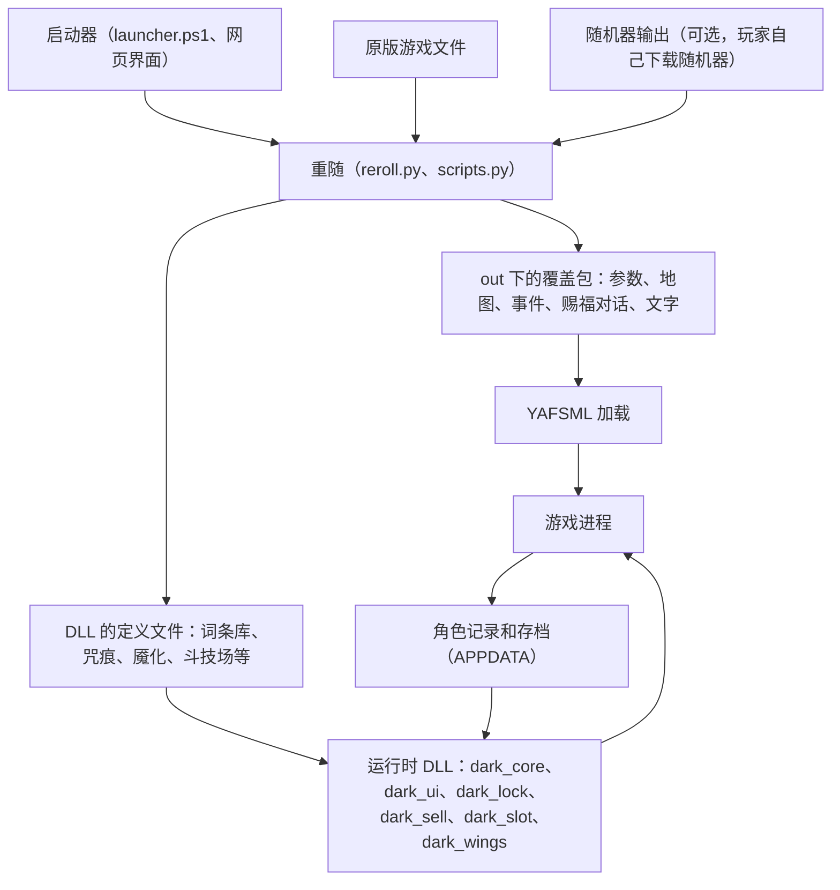

# 技术设计

**负责人：** xp271 · **状态：** 按 v0.10.12 的实现整理 · **上次审阅：** 2026-11-17

这个 mod 不能改引擎，只能改游戏读取的数据，再加上注入到游戏里的 DLL。详细的说明在各模块的源码注释和 `dev\` 下的文档里。

## 引擎与工具

| 选项 | 决定 | 原因 |
| --- | --- | --- |
| 引擎 | ELDEN RING 1.17.1（exe 2.7.1.0）/ 1.17.2（2.7.2.0），引擎本身不改 | mod 只能在原作上改；DLL 里每个游戏版本各有一套内存地址 |
| 编程语言 | Python：启动时生成参数、地图、事件脚本、赐福对话和文字（`launcher\reroll`）；Rust：运行时 DLL（`dev\dark_core` 等）；PowerShell + C#：启动器；HTML / JS：启动器的网页界面（WebView2）；C# / .NET：改地图的 `msbtool`（SoulsFormats） | Python 解释器随包自带，玩家不用装；Rust 写注入代码更安全，有现成的 fromsoftware-rs；PowerShell 是 Windows 自带的 |
| 版本控制 | git，GitHub 私有仓库 `xp271/darkforge`。`main` 对应整合包主文件夹；联机在 `coop` 分支（另一个工作目录）开发，合并后保持同步；发布打 tag（v0.10.x），`release` 分支指向最新发布 | 单人开发，主干上直接改；联机代码先在分支里定规矩，再合回主干 |
| 构建与分发 | Rust 用 gnu 工具链加 llvm-mingw 编译；`dev\tools\make_package.py` 打完整 zip，`make_delta.py` 打增量更新包，`publish_update.py` 发到 GitHub Release，GitHub Actions 再转发到 Gitee；启动器的 `update.py` 在线更新，也能导入离线更新包 | 国内玩家访问 Gitee 更快；增量更新包一般只有几 MB |
| mod 加载 | YAFSML（MIT 许可），按顺序加载覆盖包和 DLL | 不需要 Mod Engine |

## 性能目标与预算

没有单独定帧率目标，以「不比原版差」为准。规定：每帧的扫描只在穿着相关装备时才做，而且每次都要检查角色指针有效；F9 开发工具里的「帧耗时统计」能看每个模块每帧花多少时间。

| 平台 | 帧率 | 分辨率 | 内存 | 加载时间 | 安装包大小 |
| --- | --- | --- | --- | --- | --- |
| PC（配置要求同原版） | 同原版（上限 60） | 同原版 | 没有单独测过 | 启动前重随：输入没变时几秒，有变化约 20 秒；第一次开敌人随机先随机化 1～5 分钟。进游戏后的读图同原版 | 完整包 zip 约 446 MB；增量更新包一般 1～5 MB |
| 主机 | 不支持 | — | — | — | — |

## 架构

_主要系统_

- **重随**（Python）：每次启动在原版或随机器输出的数据上改，写出 YAFSML 按顺序加载的覆盖包；输入没变时沿用上次的结果，多个部分并行做。
- **dark_core**（Rust）：鉴定时生成装备、把参数写进预留的「容器」行，按词条规则在运行时触发效果；死亡以上、斗技场、卢恩银行、联机等每个功能一个模块。
- **dark_ui**：装备工坊、魇印、咒痕页这些画在游戏上的界面，通过 dark_core 导出的接口读写（两边各带接口版本号）。
- **其他 DLL**：dark_lock（物品菜单的锁定和图标）、dark_sell（一键出售、回购）、dark_slot（第五护符栏）、dark_wings（坩埚之翼飞行）。dark_dev 是 F9 测试工具，只在本机，不打包。
- **它们之间怎么通信**：重随写定义文件（`dll\dark_core\*.txt`），DLL 启动时读；事件脚本、赐福对话和 DLL 之间用事件标记（mod 自己的标记从 93000 起）；词条规则之间走 DLL 里的事件总线。

## 存档与联网

- **存档**：
  - 独立存档 `ER0000.rng`，不碰原版的 `.sl2`。
  - 新装备的生成记录在 `%APPDATA%\EldenRing\DarkReforged\角色记录\`，按存档格子（加角色名）区分；锁定列表、免费许愿、难度档这些也在里面。
  - mod 自己的进度（卢恩银行、魇印、咒痕碎片、难度锁定等）用事件标记存在存档里。
  - 每次启动前自动备份存档和角色记录（`启动前备份\`），启动器能恢复。
- **联网**：
  - 单人游戏。启动器从 GitHub 和 Gitee 同时取 `latest.json` 和更新包，哪个快用哪个。
  - 联机（Seamless Co-op，经 Steam 点对点）在开发中。规矩是全队用房主的世界，敌人一侧只让房主改，见 `dev\coop\联机计划.md` 第 13 节。
- **玩家数据**：不收集。诊断包由玩家自己点「导出诊断包」，里面是日志、设置、角色记录和崩溃时的调用栈，自己发给作者。

## 管线

- **数据和文字**：改 `launcher\reroll`（`rr\*.py`、`sc\*.py`、`settings.json`）→ 在副本上跑一遍重随检查（`safe_reroll`，不碰真实的存档和角色记录）→ 下次启动游戏时自动重随生效，几秒到 20 秒。
- **运行时功能**：改 `dev\dark_*` 的 Rust → `cargo test`（v0.10.12 时 232 个测试）→ 编译 → 游戏关着时备份旧的、复制进 `dll\` → 进游戏测。
- **词条**：`dev\item_system\extract_affixes.py` 生成词条库（缺了数值折算会拒绝写）→ 重随写 `affixes.txt` → dark_core 鉴定时读。
- **图标**：`iconkit.py` 画、`dev\bc7enc` 压缩 → 合进菜单图集。
- **数值**：`dev\power_curve` 的离线模型（重随副本 → Rust 模拟，200 次约 34 秒 → `report.html`）；`archetype_dps.py` 模拟各流派的伤害；`save_curve.py` 拿真实存档对照。
- **发布**：打包前检查（DLL 都是最新编译的、词条库重新提取后一致、两种模式的副本重随通过、更新日志已发布的段落没被改）→ `make_package` → `make_delta` → `publish_update` 发到 GitHub，Actions 转发到 Gitee（1～6 分钟）→ 玩家的启动器检查到更新。
- **测试工具**：F9 叠加界面（发物品、流派套装、帧耗时），只在本机。

## 技术风险

| 风险 | 影响 | 应对措施 | 负责人 |
| --- | --- | --- | --- |
| 游戏更新改了内存地址 | DLL 的功能失效或崩溃 | 每个游戏版本一套地址（现在 1.17.1 / 1.17.2）；启动前检查游戏版本，不对就提示、默认不启动 | xp271 |
| 改地图要用的 SoulsFormats.dll 是从随机器的程序里取出来的 | 随机器不能随包，不开敌人随机时改不了地图 | 改地图只在敌人随机模式里用；公开发布前换掉来源 | xp271 |
| 运行时改写参数行 | 写错会崩溃 | 已知的崩溃特征记下来；诊断包带崩溃调用栈 | xp271 |
| 很多功能离线测过、游戏里没逐项测 | 上线后才发现问题 | 副本重随 + 单元测试 + 玩家的诊断包；发现问题小版本快速更新 | xp271 |
| 非 Steam 正版、杀毒软件 | 启动或联机失败 | 启动器不用隐藏窗口和编码命令；诊断包里能看出非正版的特征 | xp271 |
| 联机同步 | 两边对不上、丢装备记录 | 联机存档和单机分开；房主说了算；存档标记有护栏；按钮隐藏到两台电脑测完 | xp271 |
| 启动慢 | 玩家等太久 | 输入没变时沿用上次的重随结果；重随并行 | xp271 |

## 未决问题

- [ ] 游戏再更新以后，DLL 的地址多久能跟上。xp271，游戏更新时。
- [ ] 改地图用的 SoulsFormats.dll 是从随机器的程序里取出来的，所以不开敌人随机（没装随机器）时改不了地图。公开发布前要换成能自己分发的来源，换了以后原版模式也能改地图。xp271，公开发布前。

相关文档： [界面与无障碍](06%20%E7%95%8C%E9%9D%A2%E4%B8%8E%E6%97%A0%E9%9A%9C%E7%A2%8D.md) · [制作计划](08%20%E5%88%B6%E4%BD%9C%E8%AE%A1%E5%88%92.md)
